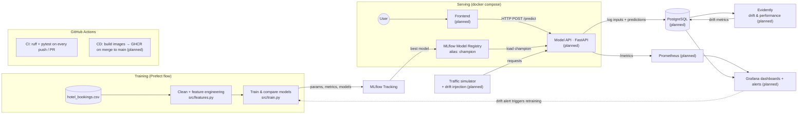
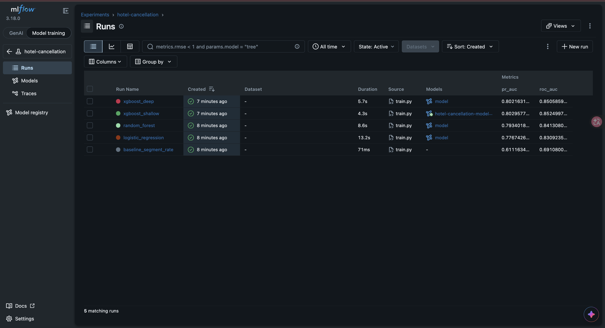
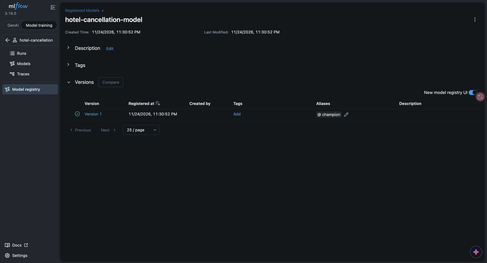

# 🏨 Hotel Booking Cancellation — End-to-End MLOps

INSY 684 group project (McGill MMA, Fall 2026). We take the hotel-cancellation model we built in INSY 674
([original repo](https://github.com/zhangaiyou07/hotel-cancellation-prediction)) and turn it into a
production-style ML system: orchestrated training, experiment tracking, a model registry, a containerized
API + frontend, and monitoring for drift.

**Team:** Group 8

| Member | GitHub | Responsibility | Feature branch |
|---|---|---|---|
| Zijia Zhang | [@zhangaiyou07](https://github.com/zhangaiyou07) | Dashboards & alerts (Prometheus, Grafana), CD to GHCR, docker-compose integration | `feature/dashboards-cicd` |
| Zexi Liu | [@zexisui](https://github.com/zexisui) | Training pipeline (Prefect), MLflow server, hyperparameter tuning, retraining | `feature/training-pipeline` |
| Cassie Yang | [@cass1eoo](https://github.com/cass1eoo) | Monitoring: traffic simulator, drift injection, Evidently, prediction store | `feature/monitoring` |
| Mo Zhou | [@MoZhou-vicky](https://github.com/MoZhou-vicky) | Model API (FastAPI), input validation, `/metrics`, integration test | `feature/model-api` |
| Siyu Liu | [@Siyu-Liu123](https://github.com/Siyu-Liu123) | Frontend, explainability (SHAP), final presentation | `feature/frontend` |

---

## Problem

37% of bookings in the [Hotel booking demand](https://www.kaggle.com/datasets/jessemostipak/hotel-booking-demand)
dataset (119,390 bookings, two Portuguese hotels) are cancelled, and every cancellation that is not re-sold
is an empty room. When a booking is **created**, the model predicts the probability that it will be
cancelled, using only information available at that moment. The revenue-management team uses the score to
set overbooking levels and to contact high-risk guests early.

- **Task:** binary classification, target `is_canceled`
- **Main metric:** ROC-AUC on an out-of-time test set (train: arrivals before May 2017, test: May–Aug 2017)
- **Baseline:** today's rule of thumb, the historical cancellation rate of the booking's
  hotel × market segment × deposit type (ROC-AUC ≈ 0.69)

---

## Architecture

> The diagram shows the target architecture. Components marked *(planned)* are still being built.



---

## Repository structure

```
├── .github/workflows/ci.yml   ← CI: lint + tests on every push and pull request
├── data/hotel_bookings.csv    ← raw dataset (Kaggle, CC BY 4.0)
├── src/
│   ├── features.py            ← cleaning, out-of-time split, leakage removal, feature engineering, pipelines
│   ├── evaluation.py          ← CV and metric helpers (from INSY 674)
│   └── train.py               ← trains candidate models, logs to MLflow, registers the best one
├── tests/                     ← unit tests (data validation, preprocessing, model sanity)
├── pyproject.toml             ← ruff + pytest configuration
├── requirements.txt           ← runtime dependencies
└── requirements-dev.txt       ← + test / lint tools
```

---

## Quick start (local)

```bash
# 1. environment (Python 3.11)
conda create -n mlops python=3.11 -y
conda activate mlops
pip install -r requirements-dev.txt

# 2. lint + tests (same as CI)
ruff check .
pytest -v

# 3. train models and register the best one in MLflow
python -m src.train

# 4. open the MLflow UI at http://127.0.0.1:5000
mlflow ui --backend-store-uri sqlite:///mlflow.db
```

`python -m src.train` logs one run per candidate model (baseline, logistic regression, random forest, two
XGBoost settings) with parameters and metrics. It then registers the best model as
`hotel-cancellation-model` with the alias `champion`.

---

## Experiment tracking (MLflow)

Every training run is logged to MLflow with its parameters and metrics, evaluated on the out-of-time test set:

| Run | ROC-AUC | PR-AUC |
|---|---|---|
| baseline_segment_rate (today's rule of thumb) | 0.691 | 0.611 |
| logistic_regression | 0.831 | 0.777 |
| random_forest | 0.841 | 0.793 |
| xgboost_deep | 0.851 | 0.802 |
| **xgboost_shallow** (registered) | **0.852** | **0.803** |

**Why `xgboost_shallow`?** `src/train.py` registers the run with the highest test ROC-AUC. The two XGBoost
models are within 0.002 of each other, which is within noise; the shallow one is also simpler (300 trees of
depth 4 vs. 500 of depth 8), so it is faster to serve and less likely to overfit.
*Known limitation:* selecting the model on the test set leaks a little information. The Prefect training
pipeline will select on cross-validation within the training data and keep the test set for final evaluation.



The best run is registered in the MLflow Model Registry as `hotel-cancellation-model`. The `@champion`
alias points at the version the API will serve.



---

## How we work (Git workflow)

1. `main` is protected: no direct pushes. Every change goes through a pull request.
2. One branch per change, named by type: `feature/…`, `fix/…`, `docs/…`.
3. The PR description says **what changed** and **how it was tested**.
4. A teammate who is not the author reviews it with real comments and approves it.
5. CI (ruff + pytest) must pass before merging. We merge with a merge commit, never squash.
6. No secrets in the repo: credentials live in a local `.env` (git-ignored) or in GitHub Actions secrets.
